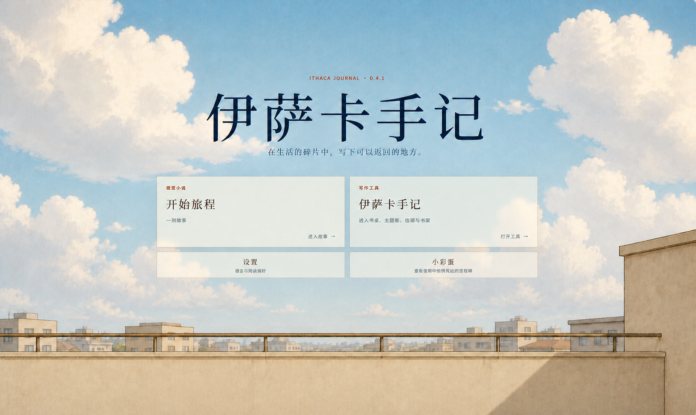

# The Ithaca Journal | 伊萨卡手记



> Development build: the left entrance opens the visual novel, the right one opens the interactive writing tool.

*The Ithaca Journal* is a Research through Design project that couples a visual novel and an interactive writing tool inside one work. Current development focuses on finishing the novel's story, staging, and playable build.

## 1. Design decision: a developer meta-story that couples the novel and the tool (DE-003)

The project first grew into an open writing space made of a desk, a topic board, a mailbox, and a bookshelf. An earlier phase tried to re-arrange those tools into a themed journey around "agency" and "communion", but the work drifted into explaining concepts and features — and still had no answer to "what story is this?".

The current decision is to turn *why anyone would build The Ithaca Journal at all* into the visual novel itself:

```text
The player enters the visual novel
  → meets a young developer who is job-hunting
    → watches him reopen and polish The Ithaca Journal
      → sees or uses the writing tool inside the story
        → the tool becomes part of an interview, an evaluation, a failure
          → the project ends where there is no next version
```

The novel follows a recent graduate who arrives in an unfamiliar city to look for work, planning to present the journal he built earlier as his interview portfolio. Diaries, fragments, topics, letters, and books surface through his experience and his memories of making them; A/B/C are merely staged versions formed before the interview; the story ends where the project quietly comes to nothing — it does not resolve by re-reading C, by resuming development, or by handing out growth as compensation.

The novel is therefore not a wrapper layered on top of a tool, and the tool is not a feature set unrelated to the story: the developer meta-story explains why the tool appeared, how it was given meaning, and how it was set aside under real pressure, while the tool becomes a concrete work that the story can operate, display, and question.

## 2. Inheritance: what this version carries over, and where

The tool is inherited rather than invented for the story, and the inheritance is deliberately made visible in three places.

**From prototype to story.** The desk, topic board, mailbox, and bookshelf — including the earlier agency/communion journey — are not thrown away. They are carried into the novel as *the developer's own design draft*, so that the previous version is not discarded history but something the story can look at, use, and doubt.

**Two layers that must stay apart.** Every narrative passage belongs to exactly one layer: `layer-reality` (the rental room, the city, the interview) or `layer-design` (the journal's design draft). The "Ithaca Cottage" exists only inside the design draft; Kafka in reality lives in an ordinary rented room. The two spaces must never merge, in text or in staging. That separation is what keeps the inherited tool honest: it is a designed object inside the story, not the world the character actually lives in.

**Releases, revisions, and passage stability.** Three things stay distinct and none of them names the story: the product release (owned by `package.json` and release records), the content revision of the Journey, and the save schema. Passage IDs express structural position only (`PROLOGUE_S01`, `CH01_S01`, `CH02_I06`, `CH03_END`, `CH04_END`); retitling or rewriting never renames them, and a passage already written into real saves is kept alive through redirects instead of deletion. The early desktop prototype also survives as the [`legacy`](https://github.com/666feiyu666/Ithaca-Journal/tree/legacy) branch — historical reference, not the development line.

The home screen keeps two independent entrances:

| Entrance | What it opens |
| --- | --- |
| **Visual novel: start the journey** | The authored developer meta-story. |
| **Writing tool: The Ithaca Journal** | The desk, the topic board, the mailbox, and the bookshelf, used on their own. |

This is the design direction currently in production, not a research finding already backed by participant evidence.

## 3. Running the project on your own machine

"Migration" here means restoring a local environment you can keep developing in: get the source, install the locked dependencies, rebuild an empty local database from the migration files, and start the app. It does not carry over the previous machine's user diaries, account data, local D1 state, or keys.

### 3.1 Get the source and install dependencies

Install Git, Node.js, and npm first, then run:

```bash
git clone https://github.com/666feiyu666/Ithaca-Journal.git
cd Ithaca-Journal
git switch main
npm ci
```

`npm ci` restores dependencies exactly as pinned in `package-lock.json`. Cloudflare Wrangler is a development dependency of the project; there is no need to install it globally.

### 3.2 Create this machine's own local key

Copy the environment example:

```powershell
# Windows PowerShell
Copy-Item .dev.vars.example .dev.vars
```

```bash
# macOS / Linux
cp .dev.vars.example .dev.vars
```

Generate a fresh 32-byte Base64URL value:

```bash
node -e "console.log(require('node:crypto').randomBytes(32).toString('base64url'))"
```

Put the output into `.dev.vars`:

```dotenv
VAULT_KEY_ENCRYPTION_KEY=replace-with-the-value-you-just-generated
```

Why an empty database still needs this key: the app creates an account key that encrypts saved content, then wraps it with `VAULT_KEY_ENCRYPTION_KEY` and stores it in the local D1. The value is not a cloud credential and not a user password — it is only the machine-level key that protects the local account key. Without it the app still loads its static pages, but the account/vault service cannot create or unwrap keys, so writing and saving do not fully work.

If you are only rebuilding an empty database on a new machine, generate a new value. Only when you deliberately move a previous machine's local user data do you need to migrate the old D1 state and the old `.dev.vars` together; copying just one of them makes the existing encrypted data unreadable. `.dev.vars` is already Git-ignored and never leaves your machine.

### 3.3 Rebuild the local database

```bash
npx wrangler d1 migrations apply DB --local
```

Wrangler applies the whole chain starting at `migrations/0001_initial.sql`. This command only creates or updates D1 state on this machine; it never touches staging or production.

### 3.4 Start the app

```bash
npm run dev
```

Before starting, it compiles and validates `narrative/journey/story.zh-CN.twee`, then Wrangler prints the local address in the terminal.

### 3.5 Verify the restoration

```bash
npm run check
npm test
npm run test:integration
npm run build
```

The minimum bar for a restored environment: dependencies install, the full migration chain applies to an empty database, the app starts locally, and type checks, unit tests, integration tests, and the dry-run build all pass.

What Git restores is the source, the migrations, the generator scripts, the tests, the Journey authoring source, and the required runtime resources. It does not restore `node_modules/`, `.dev.vars`, local D1 state, user data, logs, caches, build output, or the large art source files kept outside the repository.
