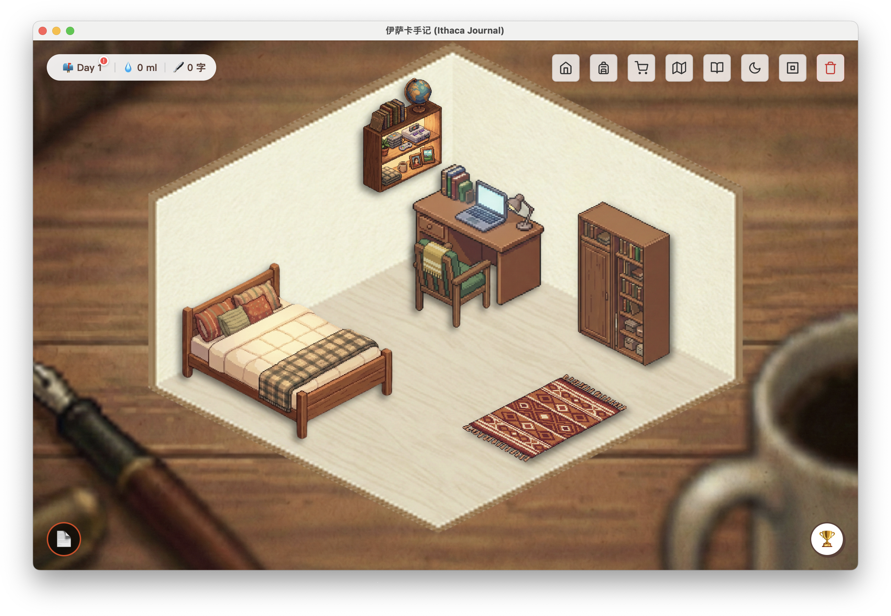

# The Ithaca Journal | 伊萨卡手记

 



**The Ithaca Journal is a desktop journal that redesigns diary-keeping as a 21-day journey: you move into an empty room, receive letters, write, and bind those scattered notes into books — until the room slowly becomes a home.**

It is not another habit tracker with points and leaderboards. It asks a different question: **when everything is in motion, how do we place ourselves back into a concrete situation — and tell a coherent story of our own?**

---

## Why we built it

Odysseus knew where he was going, and he always knew where he was coming home from — he had a coordinate called Ithaca. Most of us don't. We are thrown into a highly mobile, constantly shifting world, facing both large structural pressures and very specific everyday blows: a failed exam, a job that goes nowhere.

Many "empowerment" gamified self-help products answer this by translating those difficulties into numbers we can level up: resilience +1, mindset +1. They promise that if we keep optimizing ourselves, we will get past reality. But while we do that, the actual situation — the city you live in, the work you do, the people you meet — quietly leaves the frame. Problems are reduced to psychological ones, and people are left endlessly self-optimizing inside structural difficulties.

The Ithaca Journal takes the opposite route: **put the situation back first, and talk about growth after.** The self is not a container waiting to be filled with stats; it is something narratively built over time, through encounters with others and with the world. Writing is the plainest, most reliable way to do that building.

## Design ideas: four decisions

**1. Situation before numbers.**
The game doesn't start with "what is your goal?". It starts with *you just graduated, dragging a suitcase alone into a big unfamiliar city*. Loneliness, missing coordinates, uncertainty — those land first, so the room, the city and the light outside the window become perceptible. What you deal with is not an abstract self, but the self in this particular situation.

**2. Model the practice before asking for it.**
Once you move in, you begin receiving 21 letters from the previous tenant, "Sugar Pineapple" (糖水菠萝). They are not quest logs; they are a demonstration of narrative practice — how another person digests their own circumstances and answers the outside world by writing. What the letters mention maps onto the broken book on your shelf, *The Ithaca Journal*. Completing that book is the same act as completing the journey.

**3. The interaction is the metaphor.**
The real entry points grow on the objects in the room: the desk opens the writing desk, the bookshelf lets you look back, the mailbox delivers letters. More importantly, there is a path from fragment to whole — you jot down scattered days in separate **notebooks**, then select, reorder, and thread them together, **binding them into a book** that sits on the shelf. What is recreated at the level of interaction is narrative integration itself: weaving dispersed experience into a coherent story of the self.

**4. Rewards return to space, not to a leaderboard.**
No points, badges, or friend rankings. Every entry and every finished book earns **ink**; ink buys furniture in the shop, and you place each piece yourself in the room that started out empty. Achievement is not a number but a space you can walk back into and look at — which is what "home" means here.

## What playing it looks like

1. Open the app, move in, read the first letter.
2. Click the desk to open the **writing desk**: create a notebook ("daily fragments", "my thesis") and write whatever is on your mind.
3. When you have enough material, enter **binding mode** to select, order, and compile it into a book.
4. Look back at your books on the **bookshelf**, and **export any of them as Markdown**.
5. Spend earned ink in the **furniture shop**, then enter **decoration mode** to arrange the room.
6. Log in daily to unlock the next letter; after 21 days, *The Ithaca Journal* is complete.

Alongside that, the room keeps an achievement log and a city map (streets, the subway entrance, the shop street and more are open to wander). Saves can be exported and imported as a whole, and everything stays on your own machine.

## Project status

This repository branch (`legacy`) holds the early prototype: the room, the writing flow, the letters, and the binding loop. Active development continues on **[`main` on GitHub](https://github.com/666feiyu666/Ithaca-Journal)** — please look there for the current state, issues, and discussion.

Still being worked on:

- [ ] A smoother writing experience
- [ ] Polishing the main story and writing the side stories
- [ ] Finishing the city roaming and memory-fragment mechanics

Issues and pull requests are welcome.

## Download & run it yourself

**Prototype build.** A packaged prototype is available on itch.io for a quick look:

👉 **[Download on itch.io](https://frank-don.itch.io/ithaca-journal)**

**Full experience from source.** The itch.io build is a snapshot; running from source gives you the complete current experience. You need [Node.js](https://nodejs.org/) 20 or newer.

```bash
git clone https://github.com/666feiyu666/Ithaca-Journal.git
cd Ithaca-Journal
npm install
npm start          # launch the app
npm run dist       # package (Windows portable / macOS dmg)
```

Saves live in your system application-data directory under `save_data` (`save_data_dev_test5` in development mode): `user_data.json`, `journal_data.json`, and `library_data.json`. You can also back them up with the import/export buttons in the app.

The stack stays deliberately small: Electron (main + renderer process), plain HTML/CSS/JavaScript, `marked.js` for Markdown rendering, and local JSON files for storage.

## References & thanks

The questions behind this journal come from Homer's *Odyssey* and Charles Segal's reading of it; the parts on the narrative self and identity draw on:

- Homer — *Odyssey*
- Charles Segal — *Singers, Heroes, and Gods in the Odyssey*
- Zhang Rongnan — *The Narrative Self: How We Understand Ourselves Narratively*
- Song Wei — *A Study of MacIntyre's Ethical Narrative*
- Anthony Giddens — *Modernity and Self-Identity*
- Charles Taylor — *Sources of the Self: The Making of the Modern Identity*
- Alasdair MacIntyre — *After Virtue*
- Paul Ricoeur — *Oneself as Another*
- ...
